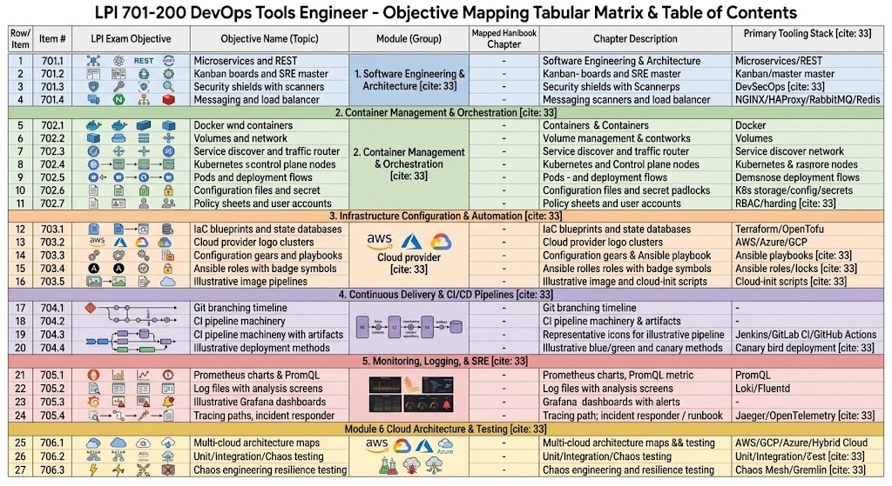

# Introduction

Whether you are a system administrator looking to streamline infrastructure or a software developer aiming to bridge the gap between writing code and shipping it seamlessly, stepping into the world of DevOps can feel both exciting and fast-paced. Modern software delivery thrives on automation, continuous integration, and robust collaboration across teams.

To help professionals navigate this evolving landscape, the Linux Professional Institute (LPI) offers the DevOps Tools Engineer certification. As outlined in the [LPI DevOps Overview](https://www.lpi.org/our-certifications/devops-overview/), this credential provides a vendor-neutral standard that focuses on practical, open-source technologies—such as containerization, orchestration, and pipeline automation—that power real-world engineering workflows. It is designed to validate the core competencies needed to build, deploy, and scale modern applications with confidence.

## Bridging Theory and Production: The Core Mission of This Handbook

This book is designed to serve a dual purpose: to act as an authoritative, **enterprise-ready reference handbook** for day-to-day engineering operations, and to provide a rigorous, **hands-on preparation guide** for the **Linux Professional Institute (LPI) DevOps Tools Engineer Exam (701-200)**.

Too often, certification guides focus solely on abstract multiple-choice theory, while enterprise manuals assume an existing mastery of foundational tools. This guide bridges that divide by merging production-grade architecture with curriculum-driven mastery.

### Key Pillars of the Handbook

* **Production-Grade Architecture & Real-World Resilience:** Beyond helping you pass an exam, this text focuses on designing resilient, scalable systems that can withstand the demands of modern enterprise environments. You will learn patterns that prioritize security, data sovereignty, and high efficiency.
* **Complete Coverage of LPI Exam 701-200 Objectives:** Every chapter maps directly to the core domains defined by the Linux Professional Institute, ensuring complete readiness across critical technology areas:
* **Software Engineering & Version Control:** Mastering Git workflows, branching strategies, and collaborative code management.
* **Continuous Integration & Delivery (CI/CD):** Building robust pipelines that automate building, testing, and deployment lifecycle stages.
* **Application Containerization:** Operating Docker and Podman to build, configure, and publish OCI-compliant container images.
* **Orchestration with Kubernetes:** Managing multi-container deployments, stateful applications, and cluster configurations using native Kubernetes resources and `kubectl`.
* **Security & Observability:** Implementing cloud-native security practices, configuring Prometheus for real-time metrics monitoring via PromQL, and managing centralized logging stacks.

* **Action-Oriented, Hands-On Labs:** Grounded in practical labs and step-by-step automation scripts, the exercises in this book ensure that you build muscle memory for the command line rather than just memorizing syntax.

Whether you are a system administrator stepping into modern automation or a software developer taking ownership of deployment pipelines, this handbook equips you with the open-source tools, practical workflows, and credentialed confidence required to excel in today’s cloud-native landscape.

## Navigating the LPI 701-200 Certification Matrix

Welcome! Standard certification blueprints can feel dry and disconnected from real-world engineering. To fix that, this guide and accompanying matrix bridge the gap between abstract exam objectives and practical, hands-on enterprise tools.

Whether you are preparing for the **LPI 701-200 DevOps Tools Engineer** exam, building internal training programs, or structuring a modern infrastructure stack, this resource is designed to help you connect theory directly to implementation.

## How to Use the Matrix

The matrix organizes the entire LPI 701-200 ecosystem into six core modules, breaking down complex topics into clear, manageable steps:

1. **Locate Your Core Focus Area:** Start by identifying the module relevant to your current project or learning goal—ranging from *Software Architecture* (Module 1) to *Cloud Architecture & Testing* (Module 6).
2. **Review Exam Weightings:** Pay attention to the objective weightings (`Topic Weight`). Higher weights (such as Kubernetes Orchestration or CI/CD Automation) signal areas that require deeper practical study.
3. **Map Tools to Concepts:** Use the **Primary Tooling Stack** column to match theoretical principles with industry-standard technology—such as associating *Infrastructure as Code* directly with Terraform or *Metrics Engineering* with Prometheus and PromQL.
4. **Follow the Chapter Structure:** Use the handbook chapter references as a sequential roadmap to build well-rounded, real-world skills.

## Suggested Next Steps

- **Self-Assessment:** Identify 2–3 sub-topics where you feel least experienced and start your review there.
- **Hands-On Labs:** Pair each tooling stack entry with a local sandbox environment (e.g., setting up a local `minikube` cluster for Module 2 or writing playbooks for Module 3).
- **Study Track Creation:** Group chapters into weekly milestones based on topic weight and complexity.

## About the Author

**Chinthaka Deshapriya Gunadasa** serves as the Chief Technology Officer (CTO) and Chief Strategic Innovator (CSI) at Cybergate Services Private Limited. As a veteran Linux Operating System Engineer with over 25 years of hands-on industry expertise, he specializes in Red Hat Enterprise Linux (RHEL), Debian, and enterprise-grade open-source infrastructure.

Holding the prestigious Red Hat Certified Architect (RHCA) credential, he is widely regarded as a pioneer and the foundational figure of RHCA certification in Sri Lanka, having driven open-source adoption and technical education across the regional tech ecosystem. He earned his B.Sc. in Special Degree in  Mathematics from the University of Sri Jayewardenepura (USJP), applying a disciplined, analytical mindset to modern systems architecture, high-efficiency engineering, and automated DevOps workflows.

An open-source evangelist at heart, his broader research and professional interests encompass data sovereignty, thermal systems engineering, and bridging historical engineering paradigms with modern software engineering. Through this handbook, he shares decades of battle-tested operational wisdom to help engineers master resilient cloud-native deployment strategies.

[Drop Windows - Go Linux Presentation](https://www.youtube.com/watch?v=IjYZZ_AI_0Y)

This video is relevant because it features the author sharing his extensive expertise and early advocacy for adopting open-source Linux systems.

## About the Publisher: CYBERGATE.ONE

Cybergate Services Private Limited is a premium technology agency dedicated to a customer-centric approach, delivering innovative, tailor-made solutions designed to meet the unique needs of every client. By bridging advanced technical engineering with robust enterprise operations, Cybergate provides a comprehensive ecosystem of products and services spanning multiple high-tech domains:

* **IT Infrastructure & Linux Expertise:** Designing and maintaining robust organizational backbones through professional Linux server management, application installation, troubleshooting, and public/private cloud implementations.
* **Professional Training & Certification:** Operating as an official partner for both Red Hat and the Linux Foundation in Sri Lanka, delivering comprehensive training programs for key certifications including RHCSA, RHCE, OpenShift, Ansible, and RHEL performance tuning.
* **Business Process Automation (BPA):** Streamlining operations and enhancing workplace productivity via customized ERP, CRM, and HRIS platforms, workflow automation, and document management systems.
* **Cybersecurity Solutions:** Protecting critical digital assets through advanced server security, penetration testing, vulnerability mitigation, and comprehensive security audits.
* **Telecommunications & IoT Integration:** Providing seamless connectivity through Cloud, Hardware, and Mobile PBX platforms alongside custom Internet of Things (IoT) applications and industrial smart solutions.
* **Sustainable Energy & Specialized Technologies:** Driving environmental sustainability with solar power implementations, energy efficiency consulting, and advanced precision agriculture tech solutions.

As the publisher of this handbook, Cybergate leverages its deep industry knowledge, open-source advocacy, and dedication to digital transformation to empower engineers with enterprise-ready insights and battle-tested operational guidance.
